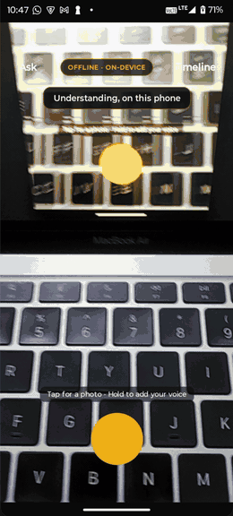

# Smriti

**Your phone remembers your work. Point the camera, say one line, ask it anything later.
Nothing ever leaves the device.**

<div align="center">



**[▶ Watch with audio and controls (2 min)](https://youtu.be/I66cuY9YyFk)**

*Capture → on-device understanding → timeline → ask out loud → answer with photo evidence.
Recorded on a Moto G05. The clip above runs at 3× speed.*

</div>

## Install it

There are no product flavors and no release APK for this build. Build from source:

```bash
source env.sh                        # JDK 21 + Android SDK
./gradlew assembleDebug              # app/build/outputs/apk/debug/app-debug.apk
adb install -r app/build/outputs/apk/debug/app-debug.apk
adb shell am start -n com.smriti.app/.MainActivity --ez smriti_seed true
```

applicationId `com.smriti.app`. The APK contains no API key because the app talks to nothing:
every model runs on the handset. It does need a language model put on the device — see
[Getting the model on](#getting-the-model-on).

---

An offline camera-and-voice work log for people whose work does not happen at a desk — site
engineers, shop owners, lab technicians, field staff. You never type. Press once: the camera
captures the artefact in front of you and you say one line about it. On-device OCR reads the
image, on-device speech transcribes the voice, and a local language model fuses both into a
structured record. Later you ask, out loud, in plain language — and it answers with the original
photograph as evidence.

> **Provenance.** This repository is a reference implementation written outside the iQOO
> Hackathon 2026 event window. The competition requires all submitted code to be written during
> the event, so this repo is not submitted and is not linked from the Phase 1 form. The venue
> build starts from an empty directory.

---

## The one rule

**The app has no `INTERNET` permission**, in every build variant, and that is enforced, not promised.

`:app:assertNoNetworkPermission` reads the *merged* manifest — the one that actually ships — and
fails the build if `INTERNET` or `ACCESS_NETWORK_STATE` appears. It exists because ML Kit pulls
in `com.google.android.datatransport:transport-backend-cct`, a telemetry uploader that declares
`INTERNET` in its own manifest, and the manifest merger added it to ours silently. The build was
green and the installed APK could open a socket.

The guard has been negative-tested: remove the `tools:node="remove"` lines and the build fails,
naming every offending entry.

## Target

| | |
|---|---|
| test device | Realme RMX5106 — MediaTek Dimensity 7300 (MT6878), Mali GPU, 8 GB RAM, Android 16 |
| language model | Gemma 4 E2B, `gemma-4-E2B-it.litertlm` (~2.6 GB) — the file Google AI Edge Gallery downloads |
| LLM runtime | LiteRT-LM (`com.google.ai.edge.litertlm`), GPU then CPU |
| speech | sherpa-onnx Whisper → Vosk → platform recogniser, all on device |
| OCR | ML Kit, Latin + Devanagari |
| recall embeddings | MediaPipe `tasks-text` text embedder |
| `INTERNET` | **absent**, enforced by the build |

## Getting it running

```bash
source env.sh                     # JDK 21 + Android SDK
./scripts/verify-on-device.sh     # build, install, seed, self-test, screenshot
```

`verify-on-device.sh` audits the APK's permissions, refuses to continue if it ever gains
`INTERNET`, checks for a model on the device, seeds a demo corpus, runs the model end to end,
and checks for crashes.

### Getting the model on

The model is never bundled in the APK. `ModelProvisioner` searches `filesDir/models`, then
`/data/local/tmp/llm`, and reports the exact paths when nothing is found. Two ways in:

**Over adb, from Gallery's copy.** If AI Edge Gallery has already downloaded Gemma 4 E2B on the
phone, copy it across on-device — no 2.6 GB push from the laptop:

```bash
adb shell mkdir -p /data/local/tmp/llm
adb shell cp /sdcard/Android/data/com.google.ai.edge.gallery/files/Gemma_4_E2B_it/*/gemma-4-E2B-it.litertlm /data/local/tmp/llm/
adb shell chmod 644 /data/local/tmp/llm/gemma-4-E2B-it.litertlm
```

**In the app, no laptop.** Tap the model badge on the capture screen to import a `.litertlm`
through the Android file picker; it is copied into `filesDir/models`.

Everything except structured extraction and answer synthesis works without the model —
capture, OCR, speech, timeline and keyword recall.

## Architecture

```
camera ─→ ML Kit OCR (Latin + Devanagari) ─┐
                                           ├─→ LlmBackend ─→ structured record ─→ Room
mic ────→ Asr ─────────────────────────────┘                        │
                                                                     ↓
                          question ─→ Embedder ─→ cosine top-k ─→ answer + evidence photo
```

`LlmBackend` has one implementation, LiteRT-LM. `Asr` is chosen by `AsrFactory` from whichever
on-device speech model is present.

**Deliberate choices worth knowing:**

- **No vector database.** Brute-force cosine over a few hundred records is sub-millisecond.
  Revisit around 10k records.
- **OCR runs both recognizers and keeps whichever read more.** The Latin model returns
  near-empty text on Devanagari, and real Indian workplace paper is routinely bilingual.
- **The extractor never throws.** A small on-device model does not reliably honour schemas:
  brace-slicing, fence stripping, trailing-comma repair, key aliases (`actions` / `actionItems` / `action_items` /
  `tasks`), arrays of strings where objects were asked for, then one shortened retry, then a
  raw-transcript fallback. Losing a capture because the model rambled is the worst failure this
  app can have.
- **Unparseable dates become no date, never a wrong date.**
- **The GPU is quarantined after one unexplained death.** See below.

## Hard-won facts

Each of these cost real time. They are here so they cost it only once.

**The GPU can segfault on Mali.** With the MediaPipe engine this app used before LiteRT-LM, a
Mali-G76 initialised, loaded the model, then died mid-generation with `SIGSEGV` at `0x0` inside
`libllm_inference_engine_jni.so`. A native crash takes the process with it, so try/catch
fallback is impossible. The RMX5106 is Mali too, so the guard stays: `LiteRtLmHolder` tries GPU
then CPU, and `BackendPolicy` writes a sentinel with `commit()` before the GPU attempt. The
sentinel stays armed until the first generation returns, so a crash during init *or* the first
answer quarantines the GPU permanently and the next launch comes up on CPU.

**LiteRT-LM writes its cache next to the model unless told otherwise.** `/data/local/tmp` is
not writable by the app, so `EngineConfig.cacheDir` points at the app's `cacheDir`.

**`litertlm-android` 0.17.0 ships Kotlin 2.4 metadata, and KSP (for Room) tops out below it.**
Kotlin stays on 2.0.21 with `-Xskip-metadata-version-check`.

**Android's on-device speech recogniser may have no language pack.** Measured on a Moto G05 on
stock Android 15: `LANGUAGE_PACK_ERROR`, code 13, for `en-US`. It fails at
`onStartListening`, not at the gesture. That is why `AsrFactory` prefers sherpa-onnx Whisper, then Vosk, and
only falls back to the platform recogniser when neither model is on the device.

**Never run Homebrew's `gradle` on this project.** It is 9.7.x, and Gradle ≥ 9.6 removed an
internal API every AGP 8.x depends on. Use the wrapper. To create one, run `gradle wrapper` in a
throwaway empty directory and copy `gradlew` plus the wrapper jar across.

**MIUI blocks the first `adb install`** (`INSTALL_FAILED_USER_RESTRICTED`), including
`pm install` as the shell user, and denies `INJECT_EVENTS` so `adb shell input tap` does not
work. Push to `/sdcard/Download` and tap once; updates over `adb install -r` then work. Stock
Android has neither restriction.

## Tools

`tools/prompt_harness.py` iterates prompt templates against Gemini or Muse Spark on the laptop,
scoring with `tools/repair.py` — a Python port of the Kotlin lenient parser, and the reference
the Kotlin must match. Its lasting value is regression-testing the repair path against real
model outputs; see `tools/README.md` for why it is *not* the right tool for choosing a prompt
for a 1B model.

## State

See `PROGRESS.md` for the full chronological log, `ARCHITECTURE.md` for the build spec, and
`PITCH.md` for the three-minute demo script.
